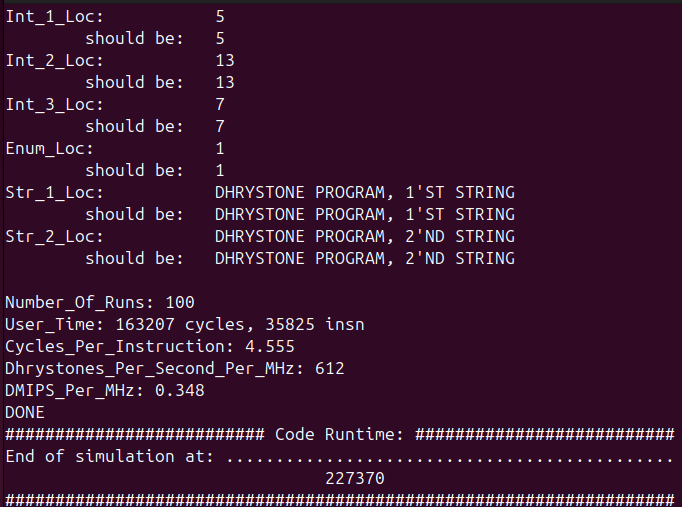
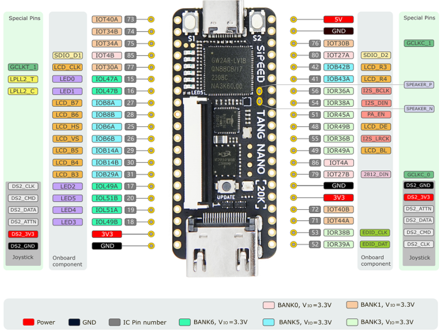
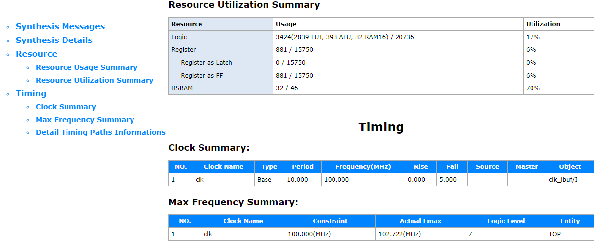
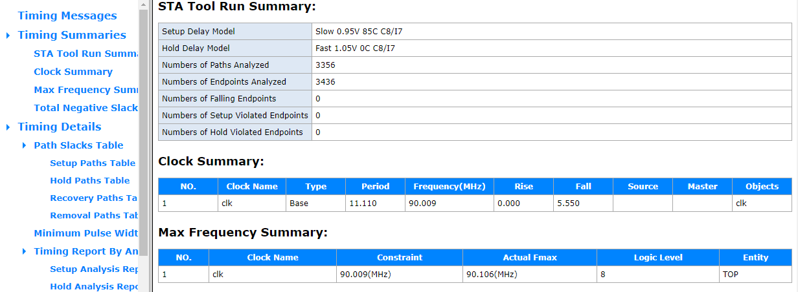
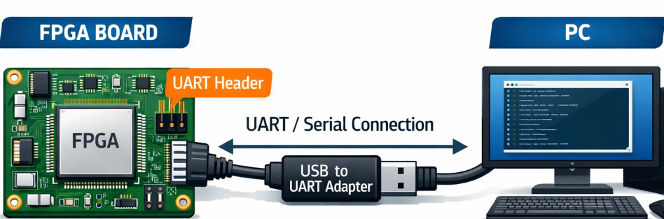
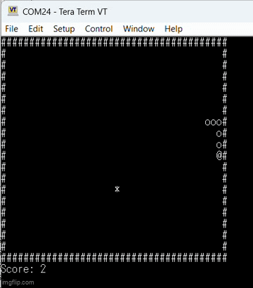

# RiSpark32: A Top-Tier Tiny Open-Source RISC-V SoC
RTL core design, testbench, benchmarking and synthesis are done without LLM models.
AI/LLM model helped to develop the Snake game


|                 |                                      |
| ----------------- | -------------------------------------- |
| **ISA**         | RV32IM + minimal Zicsr               |
| **Pipeline**    | 2–3 stages, Von Neumann             |
| **Performance** | 0.348 DMIPS/MHz · 0.75 CoreMark/MHz |
| **Frequency**   | 90 MHz (Tang Nano 20K, GoWin)        |
| **Area**        | ~3424 gates (FPGA estimate)          |

## Summary

This work presents an ultra-compact **RISC-V RV32IM** core implementation designed for resource-constrained embedded systems, featuring a **2–3 stage pipeline** and a **Von Neumann architecture** to minimize hardware complexity while maintaining practical performance. The core reaches **0.348 DMIPS/MHz** and **0.75 CoreMark/MHz**, operates on low-cost FPGA at **90 MHz**, and is implemented with an estimated footprint of **3424 gates on FPGA**, highlighting a strong area/performance trade-off for low-cost and low-power designs. In addition to RV32IM support, the core includes **minimal Zicsr extension features**, enabling basic CSR handling required for **interrupt management** and support for **tiny OS/runtime-style control flows**.

Relative to comparable open-source lightweight RISC-V cores, this open-source design is positioned as a highly competitive solution in the ultra-small RV32IM segment, especially where silicon area and implementation simplicity are primary constraints. A **live demo** showcases interactive execution on the core through a small game application (e.g., **Snake**), demonstrating both functional completeness and practical usability beyond synthetic benchmarks.

## Introduction

RiSpark32 is an ultra-compact open-source **RISC-V RV32IM** core developed for low-cost and resource-constrained embedded systems. The project focuses on achieving a strong area/performance ratio through a simple **2–3 stage pipeline**, a **Von Neumann architecture**, and a reduced-complexity microarchitecture that remains practical for real applications. The core targets educational, prototyping, and lightweight industrial use cases where predictable behavior, small silicon footprint, and easy reproducibility are key goals.

## Design Methodology and Open-Source Development Flow

The complete development flow is based on accessible tools and open material. Hardware design and verification are performed in Verilog, with simulation using **Icarus Verilog (iverilog)** and waveform inspection using **GTKWave**. The work follows standard digital design phases:

1. **Specification definition** — ISA subset, performance/area targets, interrupt strategy, memory/peripheral map
2. **Microarchitecture design** — pipeline partitioning, control path, datapath, hazard handling
3. **RTL implementation** — core + SoC integration
4. **Functional verification** — directed tests, ISA-oriented compliance, benchmark bring-up
5. **Synthesis and implementation** on FPGA
6. **System validation** through software execution and application demo

## Specification Choices and Core Architecture

RiSpark32 implements **RV32IM** with support for essential arithmetic, control-flow, load/store, and multiply/divide operations, plus **minimal Zicsr features** required for basic privileged control and interrupt handling. This CSR subset enables lightweight runtime "tiny OS" style execution models without introducing full privileged complexity overhead. The chosen 2–3 stage pipeline balances frequency and control simplicity, while Von Neumann organization reduces structural cost and routing overhead — well aligned with small FPGA devices and compact SoCs.

## SoC Integration

The core is integrated in a minimal SoC platform including:

- **Program/data memories** (on-chip RAM/FLASH mapping)
- A **basic bus/interconnect** for core-peripheral communication
- A **UART peripheral** with a simple **register bank** for software-driven I/O and debug output

This platform is intentionally lightweight but extensible, allowing future addition of timers, GPIO, SPI/I²C, interrupt controller refinements, and debug support.

A trace and logging system was implemented to follow code execution, facilitating debug and test coverage.

## FPGA Synthesis, Place-and-Route, and Target Board

RiSpark32 is synthesized and implemented using the **GoWin FPGA toolchain**, targeting the **Tang Nano 20K** platform. The reported implementation reaches approximately **90 MHz**, with compact logic usage (reported around **3424 gates equivalent / very small LUT footprint** depending on reporting style), leaving headroom on the Tang Nano 20K for additional peripherals and application logic. This remaining capacity supports future integration work such as richer game/display interfaces, sensor/control blocks, or extended SoC services, while preserving the core's lightweight identity.

## Performance Positioning

With reported results of **0.348 DMIPS/MHz** and **0.75 CoreMark/MHz**, RiSpark32 is positioned as a **first-tier tiny open-source RISC-V core** in its segment, especially for designs where implementation cost and footprint are primary constraints.

Compared with a **Cortex-M0 minimal configuration** (about **12.4 K gates** and around **0.9 DMIPS/MHz**), RiSpark32 targets a much smaller hardware footprint at approximately **3,424 gates** — roughly **3.6× fewer gates**.

In performance terms, RiSpark32 reaches **0.348 DMIPS/MHz**, lower than Cortex-M0's **0.9 DMIPS/MHz** (about **39%** of the M0 per-MHz performance). This reflects a deliberate design trade-off: the core prioritizes compact implementation and simplicity over peak scalar benchmark performance.


| Core                |     Gates | DMIPS/MHz |  DMIPS/MHz per gate |  Normalized |
| --------------------- | ----------: | ----------: | --------------------: | ------------: |
| Cortex-M0 (minimal) |    12,400 |       0.9 |     7.258 × 10⁻⁵ |        1.00 |
| **RiSpark32**       | **3,424** | **0.348** | **1.016 × 10⁻⁴** | **≈ 1.40** |

### DMIPS-per-gate ratio

```math
\text{Cortex-M0} = \frac{0.9}{12400} = 7.258 \times 10^{-5}\ \text{DMIPS/MHz/gate}
```

```math
\text{RiSpark32} = \frac{0.348}{3424} = 1.016 \times 10^{-4}\ \text{DMIPS/MHz/gate}
```

Normalized to Cortex-M0 (= 1.0):

```math
\text{Normalized RiSpark32} = \frac{1.016 \times 10^{-4}}{7.258 \times 10^{-5}} \approx 1.40
```

> By **DMIPS/gate efficiency**, RiSpark32 is about **1.40×** Cortex-M0 (≈ **40% better**).

## Lab Results

### Dhrystone results in simulation



These metrics are confirmed on FPGA (CoreMark runs on FPGA only because of its long runtime).

### Target FPGA

The **Tang Nano 20K** is the primary target FPGA platform for RiSpark32 because it offers a practical balance between cost, available logic resources, and ecosystem accessibility for rapid prototyping. This makes it especially suitable for demonstrating RiSpark32 not only as a standalone CPU core but as a complete lightweight embedded platform capable of running interactive applications (e.g., the Snake demo below) in real hardware.



### Synthesis report extraction



### Place and route report extraction



## Demonstration

Likely to be enhanced with an HDMI display instead of a terminal.



**RiSpark32 SoC bitstream + video game (Snake)**



## Future Work

1. Tiny OS porting on RiSpark32
2. More complex processing
3. AI edge peripherals
